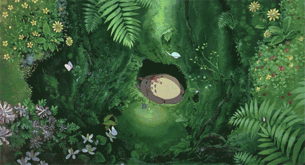
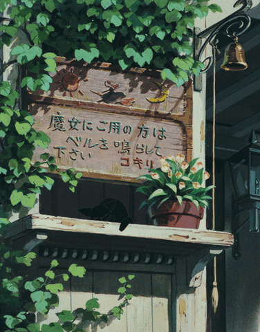

# Hello, I'm Flow 🌱

### Information Technology Student | Aspiring Developer

**You don't have to be perfect.**  
**Just keep flowing. 🌱**

*Growing at my own pace.*

---

## 🍃 About Me

Hello! I'm Flow. Welcome to my little green world!

I'm an Information Technology student at **Maejo University, Faculty of Science**.

I enjoy learning new things, exploring technology, and creating projects.

- 🎓 Studying Information Technology at Maejo University
- 💻 Interested in Web Development
- 🎨 Interested in Graphic Design and UI Design
- 🧪 Interested in Software Testing
- 🎮 I enjoy gaming, listening to music, and coding
- 🌱 Always learning and improving myself

## 🌿 Tech Stack

## 🌳 Featured Project

### ✈️ Travel-Project

**A Personal Learning Project**

A full-stack web application developed as part of my university learning journey. This project helps me practice web development, understand how frontend and backend systems work together, and improve my programming skills.

**✨ What I Learned**
- Building user registration and login
- Creating and managing travel plans
- Developing frontend pages with Next.js
- Connecting frontend and backend using REST APIs
- Managing data with MySQL
- Practicing CRUD operations (Create, Read, Update, Delete)

**🛠️ Technologies Used**
- **Frontend:** Next.js, TypeScript
- **Backend:** Java, Spring Boot
- **Database:** MySQL

🌱 *This project is still a learning experience, and I hope to improve and expand it with more features in the future.*

🔗 [Explore my Travel-Project](https://github.com/sarangiluv/Travel-Project)

---

## 🌼 A Little Reminder

### Keep learning. Keep growing. Keep flowing.

**Thanks for visiting my little forest! 🌿**

*See you on my next adventure.*

